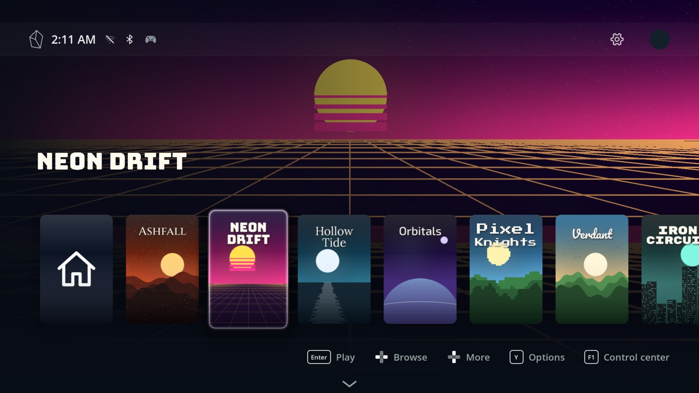
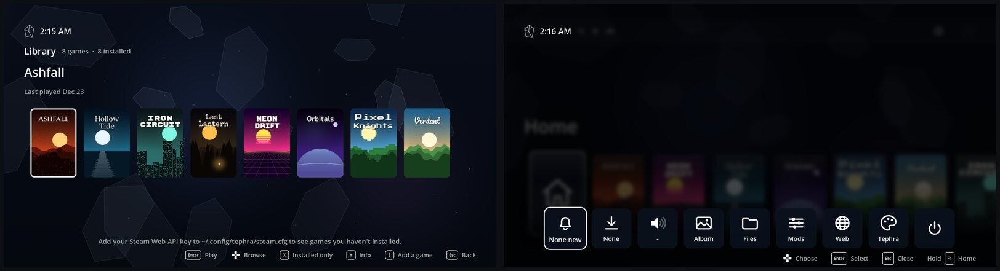
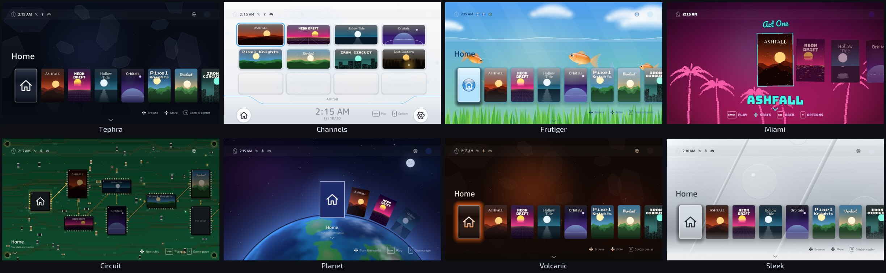

# Tephra

**A console-style, controller-only shell for Linux.** Your PC boots straight into a home screen like a PS5's. Your Steam and PS2 games are there, and everything works with a controller. No desktop, no Steam windows, no popups.



<sub>The games in these pictures are made up for the screenshots; Tephra shows your own.</sub>

## Install

You need **Arch Linux** (or an Arch-based distro) with **KDE Plasma on Wayland**. Then run one command:

```bash
curl -fsSL https://raw.githubusercontent.com/wintrsson/tephra-os/main/install.sh | bash
```

It installs what Tephra needs, puts Tephra in `~/tephra` and starts it when you log in. It also asks whether the PC should boot straight into Tephra. Restart, and on the first start Tephra walks you through Wi-Fi, Steam, your controller and a theme.

If you'd rather read the script before running it:

```bash
git clone https://github.com/wintrsson/tephra-os ~/tephra
cd ~/tephra && ./install.sh
```

**Updates** come by themselves. Tephra checks this repo, and the control center offers each new version. If a new version doesn't start, Tephra goes back to the old one.

**Uninstall** with `~/tephra/uninstall.sh`. Your games and Steam are left alone.

## What's in it

- **Home and Library.** Your installed games, everything you own on Steam, and game pages with achievements, play time and storage.
- **Control center** on the PS / Guide button: volume, Wi-Fi, downloads, notifications, screenshots, files, a browser and power.
- **Themes**, each with its own look, sounds and music. All the art and sound are original.
- **PS2 games** through PCSX2, with cover art and RetroAchievements next to Steam's.
- **Controllers.** DualSense (lightbar and player lights), Xbox and Switch layouts, plus an on-screen keyboard you can also type into from your phone.
- **Screenshots and recording** from the controller's touchpad.



### Themes



## Good to know

- **It's early.** Tephra is a one-person project and it changes fast. It has been tested on one PC (Arch, KDE Plasma 6 on Wayland, NVIDIA).
- **Steam runs hidden underneath.** You sign in to Steam once at first start. Library-wide info (games you own but haven't installed) needs a free [Steam Web API key](https://steamcommunity.com/dev/apikey).
- **The NVIDIA driver** isn't installed for you. The installer tells you if it's missing.
- **BIOS files** for emulators aren't included. Use your own.

## For developers

- `shell/tephra-shell/`: the Godot 4.7 project. `home.gd` is the main shell, and `VERSION` is bumped every release.
- `tools/check.sh` compiles every script headless. `tools/ui-test.sh` runs Tephra under Xvfb and takes screenshots.
- `configs/` holds the autostart entries, udev rules and system files. `install.sh` sets these up.

## Licence

[GPL-3.0](LICENSE). The fonts are under their own free licences (see `shell/tephra-shell/assets/fonts/LICENSE.txt`).
